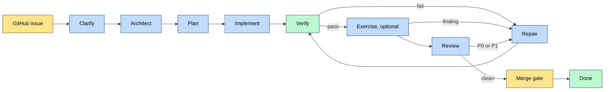
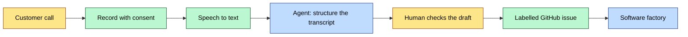

> **TL;DR:** I built a software factory that takes a labelled GitHub issue and produces three stacked pull requests:
> architecture, plan, and implementation. Humans approve at each gate. Deterministic code owns state, Git, and checks;
> agents do the thinking and the editing. On a real repository, five features cost $12.45 in agent spend. The only
> step of my lifecycle that I did not build is the first one: recording and transcribing the customer conversation.
> I think it fits the same pattern, and I describe how it would connect.

In an earlier article I described [the human-governed AI software development lifecycle](/human-governed-ai-software-development-lifecycle) as a model. This article is
about the implementation. It covers the steps I actually tested in my software factory, what each step does, and
what I learned. The final part covers the step I did not build.

## The factory in one picture

The factory watches a repository for issues that carry a label. Each issue becomes a *feature* that moves through
a state machine. Every state change is saved to a SQLite database before its side effect runs.



Yellow is a human gate, blue is an agent, green is plain deterministic code. The split is the main design rule:
agents do not own Git or GitHub. The factory commits, pushes, and opens pull requests. An agent only edits files
and writes its answer.

## The steps I tested

### 1. Intake

A deterministic poller finds an issue with the right label, from an authorized user, and records it. No agent runs
here. The issue text is the only input.

### 2. Clarify

This is the step I did not expect to matter so much. An agent reads the issue and the repository, then writes a
*brief*: what it thinks it was asked, what it assumed, and up to three questions. Each question has a proposed
default answer. The factory posts the brief as an issue comment and waits.

The human replies `/approve`, or answers the questions. The brief then becomes part of the record and outranks the
raw issue text for the next stage.

The live test was an issue titled "Speaker identification" with an empty body. The factory produced an 8.6 KB
brief that cited real files and line numbers. It asked two questions that really changed the architecture, and it
rejected a second reading of the title with a reason. It took five and a half minutes and cost $2.27.

### 3. Architect, then plan

Two more agent stages follow, and each one ends at a human gate:

- **Architecture.** The agent writes a detailed design and a short overview for humans. The factory opens an
  architecture pull request.
- **Plan.** After approval, the agent turns the design into an ordered implementation plan. The factory opens a
  plan pull request, stacked on the architecture one.

The stack matters. Each pull request shows only its own artifact. A reviewer sees the design in one place, the plan
in another, and later the code. A change request at any gate sends the feature back for a revision of that
artifact only.

### 4. Implement

The agent reads the approved artifacts from disk and edits production and test files. The factory, not the agent,
fences and commits the change. An empty or incomplete answer from the agent fails the stage. It never counts as
success.

### 5. Verify

This stage is plain code. It runs the configured checks in order, stops at the first failure, and stores the logs.
It does not trust what the agent says about its own tests. An agent claim of "tests pass" is not evidence.

### 6. Repair

A failed check goes back to an agent with the exact failing output. The factory commits any change and verifies
again. The loop has three exits:

- the repair budget ends (default 10 rounds);
- two rounds in a row change nothing;
- the review finds a P0 or P1 problem that repair cannot fix, and the feature escalates to a human.

### 7. Exercise (optional)

Verification runs checks. Review reads a diff. Neither one runs the thing that was built. The optional
*exercising* stage fills that gap. It sits between verify and review and is off until the configuration names how
to start, probe, and stop the application:

```yaml
exercise:
  start: docker compose -f compose.factory.yaml up -d
  ready: curl -sf http://localhost:3000/healthz
  stop:  docker compose -f compose.factory.yaml down -v
```

With that in place, an agent starts the application, drives it with a browser or with the CLI's own commands, and
reports what it saw with a severity. A finding goes to repair; a clean run goes to review. I added this stage late
and ran it only on the factory itself, not on the customer repository.

### 8. Review

A separate review agent reads the specification, the diff, and the evidence. It returns findings with a severity.
P0 and P1 findings block delivery and trigger repair. P2 findings get one last repair round, then the feature may
ship with the verdict recorded.

On a real pull request, the review agent found three defects. Two of them no human had noticed.

### 9. Merge

A human merges, or an optional coordinator merges the stack one edge per tick. Conflicts send the feature back to
repair. Objective failures put it in `blocked`, where a human chooses the way out.

## What worked on a real repository

I ran the factory against a real project, not only against test fixtures. Three features reached the end of the
pipeline or close to it:

| Issue | Result | Spend |
|---|---|---|
| #44 | Clarification brief from an empty issue | $2.27 |
| #73 | Three-PR stack at `awaiting_merge`, 722 tests green | $7.88 |
| #77 | Architecture and plan PRs, 417 tests green | not measured |

Five features in total cost $12.45 in agent spend.

Different stages can use different agent tools. The configuration names a backend, a model, and an effort for each
stage: Claude, Codex, OpenCode, or KiloCode. The lifecycle does not depend on one vendor.

## Dark mode: an agent at the gate

The three human gates are the slow part. Each one waits for a person to read an artifact and reply. To test how
far the pipeline can run without me, I added *dark mode*: a gate agent reads the brief, the architecture, or the
plan and answers `GATE: APPROVED` or `GATE: CHANGES REQUESTED` in place of the human.

Two rules make this safe enough to try:

- **A different model judges.** The gate agent must not be the model that wrote the artifact, or it usually
  agrees with itself. The configuration routes the producer and the operator to different backends:

  ```yaml
  agents:
    default: claude|opus|xhigh
    operate-architecture: codex|gpt-5-codex|low
    operate-plan: codex|gpt-5-codex|low
  ```

- **The agent cannot merge.** Dark mode never merges a branch. A gate that runs out of rounds, or whose answer
  is not readable, moves the feature to `blocked`, where a human decides.

I ran dark mode only on the factory's own repository. It carried about 80 of the self-hosted features through the
gates. It has not run against a customer repository, so I count it as a working experiment, not a proven step.

## What did not work

Passing tests were not enough. Mocks hid real failures.

- A live GitHub check showed that an approval on the clarification issue could release the architecture gate.
- A duplicate approval crashed the daemon until someone edited the database by hand.
- The review stage was dead in production while 950 tests were green. The fakes finished at once, so they could not
  model a real asynchronous process.

The factory also drifted. After the first results, it mostly ran on itself. By the time I audited it in September,
about 80 self-hosted features had cost roughly $2,700, and almost none of the defects found came from the customer
repository. The audit says it clearly: build the factory with ordinary human-reviewed pull requests, and use the factory only on target
repositories.

Humans still did real work: they answered gates, ran real GitHub and Git rehearsals, and fixed the cases where the
factory could not advance a feature. That is not a failure. It is the control point the model asks for.

## The step I did not build: the customer conversation

The factory starts at a GitHub issue. In the full lifecycle, the start is earlier: a person talks to a customer.
Today a human listens, remembers, and writes the issue. This is the weakest link. Details are lost, and the
issue is the human's interpretation, not the conversation.

I did not implement this step. I think it can be automated in the same way as the others.



The parts:

1. **Record.** The call is recorded with the consent of all people on it. This is a legal and trust question
   first, a technical one second.
2. **Transcribe.** A speech-to-text model produces the transcript. It can run on a local GPU, so the conversation
   does not leave the company network.
3. **Structure.** An agent cleans the transcript and extracts requests, constraints, open questions, and things
   that were said but should not be built.
4. **Human check.** A person reads the draft. The transcript says what people said. It does not say what the
   company should do.
5. **Issue.** The approved draft becomes a labelled issue. The transcript is attached, so the clarify stage can
   cite it.

The factory already has the right entry point. The clarify stage turns a vague issue into a brief with questions.
A transcript is a richer input for the same stage. The factory also already keeps agent transcripts and timelines as
artifacts, so storing the customer transcript beside them follows the same rule: every decision should trace back
to its source.

Two risks need an owner before this step goes live: privacy of the recording, and the agent turning a casual remark
into a requirement. The human check in step 4 is there for the second risk.

## What I take from this

- Put humans at the gates, not inside the work. Three approvals per feature were enough.
- Let code own state, Git, and checks. Let agents own judgment.
- Do not trust an agent's report of its own tests.
- Test on a real repository early. Mocks gave me green builds and a dead review stage.
- Do not let the factory become its own main customer.

The customer conversation is the next gap to close. I have not tested it yet, so everything in the last section is
a design, not a result.
