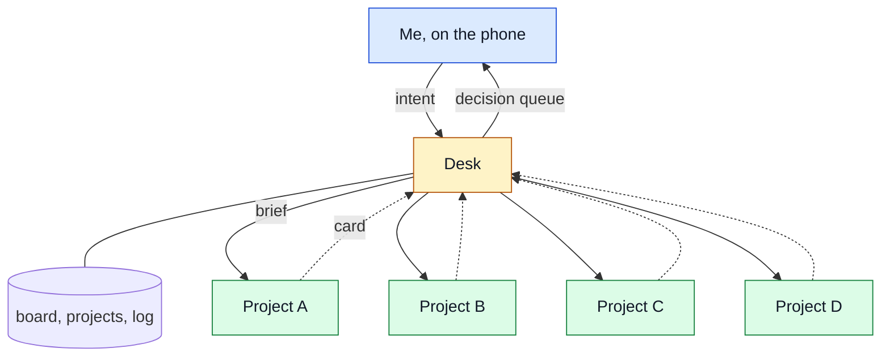

*How to Manage Many AI Agents with an ADHD-Like Mind*

**How do you run your agents? And how many?**

In the last year and a half with AI, I started more projects on my computer than in the previous 15 or 20 years of my career. Hobby projects, software experiments, business ideas I was testing, real businesses, this blog, a book, and many more. A new project joins the pile every month, sometimes every week.

But one human mind can hold focus on only about five things at once. Past that point, the projects start to drain your energy. You forget what you worked on. You postpone decisions. You spend your effort managing projects and remembering details, not moving toward their goals.

Sound familiar?

For me, AI changed how it feels to build. I can now implement almost any idea within hours, and that is very
cool. It is also addictive: every finished idea invites the next one, right away. I do not have an ADHD
diagnosis. But with AI, my difficulties look like what people with ADHD describe: my mind jumps between many
ideas, AI lets me start all of them, and the projects pile up. The desk does not make me start less, but it keeps
my many projects under control. If you do have ADHD, it may be useful to you too.

> **TL;DR:** One Claude session, the desk, sends each coding agent a brief, gets a short decision card back, and
> keeps a board in Markdown files. I answer decisions by number from my phone. In the first four days the desk
> sent 91 briefs and logged 97 of my decisions across 14 projects.

## The problem

Each project gets its own agent: an interactive Claude Code session in a Herdr pane (Herdr is a terminal workspace
for agents). On a normal day five to ten of them work at once. They are fast. Keeping up with them is not.

- **Decisions were scattered.** Every worker asked its own questions in its own pane. I found some of them hours
  later.
- **Permission prompts waited.** A worker stopped on a prompt in a tab I was not watching, and nothing moved.
- **Context got lost.** When a session ended or compacted, the reason for a decision often went with it.
- **No single view.** To answer "what is going on?" I had to visit every pane.

I did not need a smarter agent. I needed a front desk.

## The solution

The desk is one more Claude Code session. Its instructions say: you never do project work yourself. You dispatch
briefs, collect decision cards, keep the board, and put decisions in front of me in the smallest possible form.



## It is simple

Nothing here is complex. The desk is a plain project directory with Markdown files: a board, one file per project,
a decision log and two brief templates. One Claude Code agent works in that directory. No server, no framework, no
database.

The desk session runs with Remote Control on. So I talk to it from the Claude app on my phone, from anywhere.

The pieces already exist. Claude Code sessions can message each other natively, so a worker sends its card straight
to the desk. Herdr gives terminal control: list the panes, read their output, send them input. The desk uses it
through its shell to send a brief into a worker's pane and to check which workers are busy. Claude Code, Herdr and
Markdown files. No custom integration.

## The flow

1. **Brief.** I tell the desk my intent in a few words. The desk fills the template: goal, scope, constraints, and
   what "done" means. It saves the brief as a file and sends it into the worker's pane. The brief is
   self-contained, because the worker shares none of the desk's context.
2. **Card.** The worker does the job in its own repository. When it is done or needs a decision, it sends the desk
   a card. The first line is a summary, because the first line is all I see in a preview.
3. **Queue.** If the card needs a decision, the desk adds it to a numbered queue and sends me one push
   notification.
4. **Answer by number.** I reply "1 yes, 2 B, 3 park". The desk logs each answer and briefs the worker again.

I call this meta prompt engineering. There is some irony in it. For years we called it prompt engineering and
tried to squeeze the most out of every prompt. Now I write a few words of intent, and the desk writes the full
brief and prompts the agent for me.

A card looks like this:

```text
CARD tusk: PR 89 open for the PYTHONPATH fix
Done: opened the PR, not merged; no other branch changed
Next: you review and merge PR 89
Need from you: none
Default if silent: wait
Look at: <PR link>
```

## The rules that matter

The desk has eight rules. These four do most of the work.

**State lives in files, not in the chat.** A start hook prints the board, so I can clear the desk's context at any
time, and it costs nothing.

**The desk never reads project source.** No diffs, no transcripts. A subagent reads and returns one paragraph.

**Worker reports are leads, not evidence.** "Done, tests pass" means "look here". It does not mean "verified".

**At most five active projects.** A sixth one goes to Parked, or replaces one. I decide which.

Two more prevent accidents: permission prompts inside a worker stay mine, and only one worker at a time uses the
browser.

## After four days

The desk started on 31 October. Most decisions since then are small: "push it", "open the PR", "park it". That is
the point. A decision that needs more than one screen of context does not go through the desk. The desk names the
pane, and I go there.

The rules are not perfect yet. As I write this, the board has six active rows, and the first item in the queue is
the desk asking me which one to park. At least it asks.
