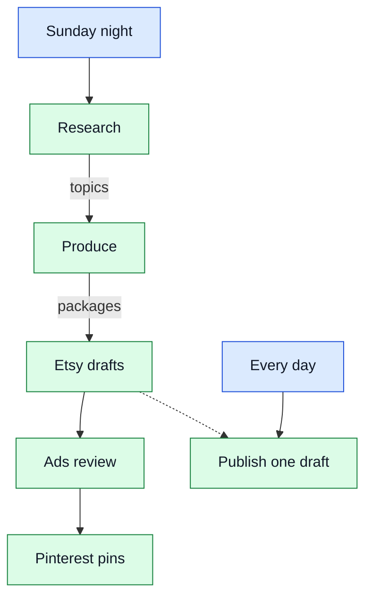

> **TL;DR:** I use AI agents as a proxy for almost everything I do on a computer. They write my code, run my job
> search, plan my day, run my online art shop, write my email replies and fix my Ubuntu. A pie chart of my own
> Claude Code, Codex and ChatGPT sessions shows the rest.

People often ask me what I actually do with agents all day. Here is the honest answer. First my workflows, in my
own words. Then all the use cases I found in my logs.

## My workflows

### Coding

I write code with coding agents, of course. Most of it does not happen in a chat. My
[software factory](/automated-ai-sdlc-what-i-tested-in-my-software-factory) splits an issue into stages and gives
each stage to an agent in its own git worktree. Another agent reviews the pull requests on a schedule. I review
what comes out. When many agents run at once, the [desk](/desk-one-chat-for-many-coding-agents) keeps track of
them for me.

### Job search

[JobPilot](/job-searching-in-2026) runs on AI agents and on regular scripts and code together. Code collects,
filters and stores the vacancies. A headless agent reads each one, compares it with my profile and gives it a
score. Another agent screens freelance posts. I see only the few jobs that survive.

### Mentor bot

I run a [mentor bot](https://github.com/vovka/mentor-bot) on my local machine. It is a deterministic scheduler that runs AI. The schedule is plain code.
At fixed times it starts an agent. In the morning the agent closes yesterday and sets today's priorities. When a
plan changes, it comments on my project priorities, like a mentor would.

### An Etsy art shop

My [Etsy art shop](https://www.etsy.com/shop/SynthSketchShop) is completely automated. The work is split into specific tasks, and each task is one job.
Tested Python decides everything that has a fixed rule: dates, thresholds, what is already listed, ad spend.
Agents do the parts that need judgment: trends, prompts, listing text, image review.

- **Research** investigates trends. It reads the holiday calendar, my Pinterest stats and demand outside Etsy.
  Then it picks one to seven topics for the week.
- **Produce** generates the content for each topic: the art, the mockups and the listing text. A review loop
  rejects weak images and makes them again.
- **Drafts.** Each finished package becomes an Etsy draft.
- **Ads review** analyses advertising. Python rules read the shop stats and decide which ads to switch on or off.
  An agent applies the decisions and writes a report.
- **Pins.** An agent pins the new listings to Pinterest.
- **Publish** is a separate daily job. It makes one draft live through the Etsy API.

When a run fails, a night watch job gives each failure to a fix agent and sends me a digest. For now I start that
one by hand.

### A book

I recently wrote [a book](https://shcherbyna.me/book/) with the same coding agents. It became possible because I use AI agents as a proxy for
everything I do. Every session leaves a log. Today my disk holds about 4.4 GB of them: 3.3 GB from Claude Code and
1.1 GB from Codex. That is months of my own work in plain text, and I can use it for reflection. One use is a book
from my own experience. This article is another.

### Email

I do not open Gmail anymore. I open one specific agent session. It connects to my Gmail and to my other personal
mailbox, and it writes the replies for me.

### Search

I barely use Google today. Finding, comparing and analysing takes too long. I ask an agent to find the
information, compare the options and give me the best one.

### My own Ubuntu

Sometimes my Ubuntu fails: a kernel panic, a broken desktop environment, or another issue. Before, I read the
logs by hand and searched the internet and Stack Overflow. I almost never found the real fix for the root cause.
Now I run an agent. By my own estimate, in 9 cases out of 10 it fixes the real root cause and improves my OS
configuration on the way.

### Other use cases

A few more things I hand to agents:

- **Operating the agents.** Much of what I type goes to the agents themselves. I update their global
  instructions, resume the factory after a usage limit and clean up stale worktrees.
- **Hardware and electronics.** I ask about split keyboard firmware
  ([that is how I met QMK](/how-i-met-qmk)), small circuits and wiring for home power. The agent explains a circuit
  or identifies a part.
- **Everyday life and paperwork.** The origin of a word, a recipe, which brand to buy, a paperwork question, a
  health question. I ask the agent instead of a search engine.
- **Writing and promotion.** The agent proofreads a text, puts a screenshot into a blog post and plans the launch
  posts.
- **Learning and interview preparation.** The agent makes a preparation plan and helps me with questions for
  an interview.

### From the phone

I can do most of this from my phone while the laptop is on. If the laptop is off, I cannot reach the sessions.
When I switch it on, [Herdr](https://herdr.dev) restores and resumes all of them, and I continue where I stopped.

## All use cases

I checked this story against my own logs: Claude Code and Codex sessions, and the titles of my ChatGPT
conversations. A script took the first prompts of each session, and Haiku, a small and cheap model, gave each one
a task type.

*All 21 task types I found, with the ten smallest merged into "Other". The share counts sessions, not time:
scripted pipelines such as job search and code review run many short sessions.*

A label comes from the first prompts only, so a session that changed topic counts as its first topic. Read the
chart as a rough map.

## What I take from this

Agents are no longer a tool I open now and then. They sit between me and almost everything I do on a computer.
The agents that do the most work are the ones I do not talk to, so the lever is another pipeline, not a better
prompt. And operating them is real work. That is why I built the desk.
